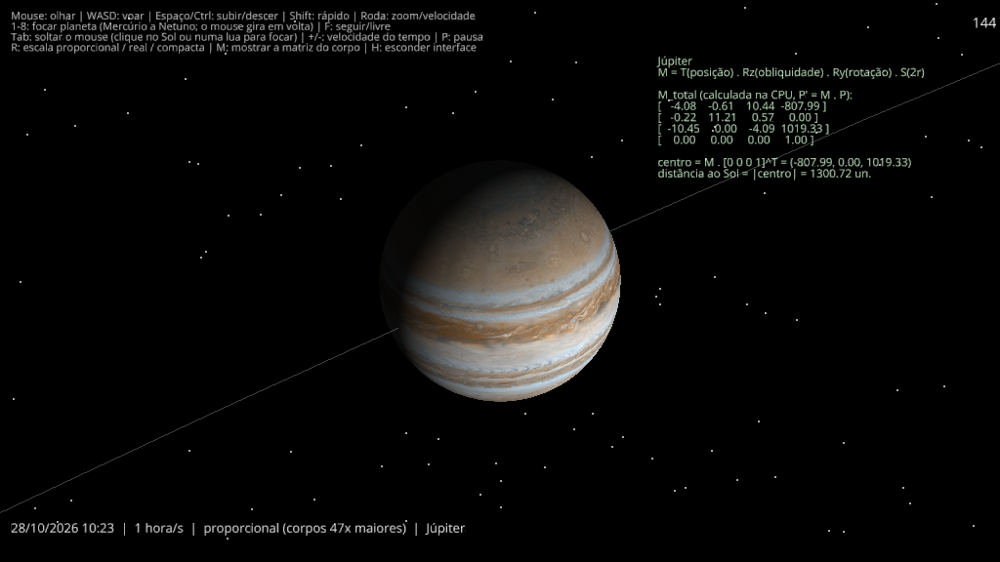

# Simulador 3D do Sistema Solar — Projeto A3

> **EN:** Interactive 3D Solar System simulator in Python/Ursina built for a Computer Graphics course (UNICURITIBA). Every body's 4×4 model matrix is composed on the CPU from scale, rotation and translation matrices in homogeneous coordinates, with UV-textured spheres, Lambert lighting, 20 major moons and a spectator camera.

Projeto A3 da unidade curricular **Computação Gráfica e Realidade Virtual** (UNICURITIBA, Prof. Rubem Matimoto Koide). O simulador aplica vetores, matrizes e transformações em coordenadas homogêneas, como apresentados nas aulas.



## O que o simulador faz

- O Sol, os 8 planetas e 20 luas principais aparecem com texturas reais (mapeamento UV).
- As órbitas são circulares, com `x = R·cos θ` e `z = R·sen θ`, calculadas pela matriz de rotação aplicada ao ponto `(R, 0, 0, 1)`. Ao abrir, cada planeta começa na sua posição média do dia de hoje.
- Cada corpo tem a sua matriz `M_total = T · R · S`, calculada na CPU e enviada à GPU. A tecla **M** mostra essa matriz ao vivo.
- Cada planeta gira no próprio eixo, com a inclinação real do eixo. Urano fica quase deitado, e os anéis de Saturno ficam no plano do equador.
- A iluminação é a de Lambert, `N·L`, com o Sol como fonte de luz.
- Há três escalas (tecla **R**):
  - **proporcional** (padrão): tamanhos e distâncias na proporção real entre si;
  - **real**: o mesmo fator para tamanhos e distâncias;
  - **compacta**: tudo comprimido para caber na tela.
- A câmera é de espectador: o mouse olha, WASD voa e as teclas 1 a 8 seguem um planeta em 3ª pessoa.

A matemática de cada parte, ligada às aulas, está em [docs/Matematica_do_simulador.md](docs/Matematica_do_simulador.md).

## Como rodar (Windows)

O simulador precisa de **Python 3.12 ou mais novo**, porque o Ursina 8.3.0 não instala no 3.11.

1. Confira a versão: `python --version`. Se for 3.11 ou mais antiga, instale o Python 3.13 (`winget install Python.Python.3.13`) ou baixe em [python.org](https://www.python.org/downloads/).
2. Na pasta `codigo`, instale a dependência:
   ```
   python -m pip install -r ..\requirements.txt
   ```
3. Rode:
   ```
   python sistema_solar.py
   ```

Se o `python` do terminal continuar sendo o 3.11, chame o 3.13 pelo caminho completo (no PowerShell):

```
& "$env:LOCALAPPDATA\Programs\Python\Python313\python.exe" -m pip install ursina==8.3.0
& "$env:LOCALAPPDATA\Programs\Python\Python313\python.exe" sistema_solar.py
```

**No PC da faculdade:** se não der para instalar programas no computador, confira antes da apresentação se ele já tem o Python 3.12 ou mais novo.

## Controles

| Tecla | Ação |
|---|---|
| Mouse | olhar (o cursor fica preso na janela) |
| W A S D | voar (para onde a câmera olha) |
| Espaço / Ctrl | subir / descer |
| Shift | mais rápido |
| Roda do mouse | aproximar ou afastar (seguindo um planeta) / velocidade do voo (câmera livre) |
| 1 – 8 | seguir Mercúrio … Netuno (o mouse gira em volta) |
| Tab | soltar o mouse (clique no Sol ou numa lua para seguir) |
| F | alternar entre seguir e voar livre |
| + / − | velocidade do tempo (de tempo real até 1 ano/s; começa em 1 hora/s) |
| P | pausar tudo (solta o mouse) |
| R | trocar a escala |
| M | mostrar a matriz 4×4 do corpo seguido |
| H | esconder a interface (para prints) |
| Esc | fechar |

Opções de linha de comando: `--captura arquivo.png` (salva uma imagem e fecha), `--foco Terra`, `--dist 6`, `--data 2026-10-28`, `--real`, `--compacto`.

## Estrutura

```
codigo/
  sistema_solar.py        cena, câmera, interface e Model Matrix de cada corpo
  transformacoes.py       vetores e matrizes 4x4 (S, T, Rx, Ry, Rz, composição) sem NumPy
  orbitas.py              órbitas circulares e dados das luas
  texturas.py             esfera paramétrica com UV, anel com UV e carregamento das texturas
  shader_solar.py         shader GLSL com iluminação de Lambert
  dados_planetas.py       dados físicos dos planetas (NASA Planetary Fact Sheet)
  resultados_parciais.py  verificações da entrega parcial (12/10/2026); grava gráficos em ../entrega/
  texturas/               texturas do Solar System Scope (CC BY 4.0)
docs/
  Matematica_do_simulador.md
  imagens/
```

## Desempenho medido

De **125 a 157 FPS** em um PC com GeForce RTX 3060 e Intel Core i7 de 11ª geração, com Python 3.13 e Ursina 8.3.0 (28/10/2026).

## Fontes e créditos

- Órbitas: JPL/NASA, *Approximate Positions of the Planets*, Tabela 1: https://ssd.jpl.nasa.gov/planets/approx_pos.html
- Luas: JPL, *Planetary Satellite Mean Elements*: https://ssd.jpl.nasa.gov/sats/elem/sep.html. NASA NSSDC, *Uranian* e *Neptunian Satellite Fact Sheets*.
- Planetas: NASA, *Planetary Fact Sheet*: https://nssdc.gsfc.nasa.gov/planetary/factsheet/
- Texturas: [Solar System Scope](https://www.solarsystemscope.com/textures/), licença CC BY 4.0.
- Motor: [Ursina](https://www.ursinaengine.org/) 8.3.0 sobre o Panda3D.

## Limites conhecidos

- As órbitas são circulares e estão todas no mesmo plano. Por isso Mercúrio e Marte ficam alguns graus fora da posição real.
- A posição inicial das luas na órbita não é a real.
- No modo proporcional, as luas aparecem 4 vezes maiores que a proporção real, para ficarem visíveis.
- A direção do eixo de cada planeta é simplificada. Só o ângulo de inclinação é real.
